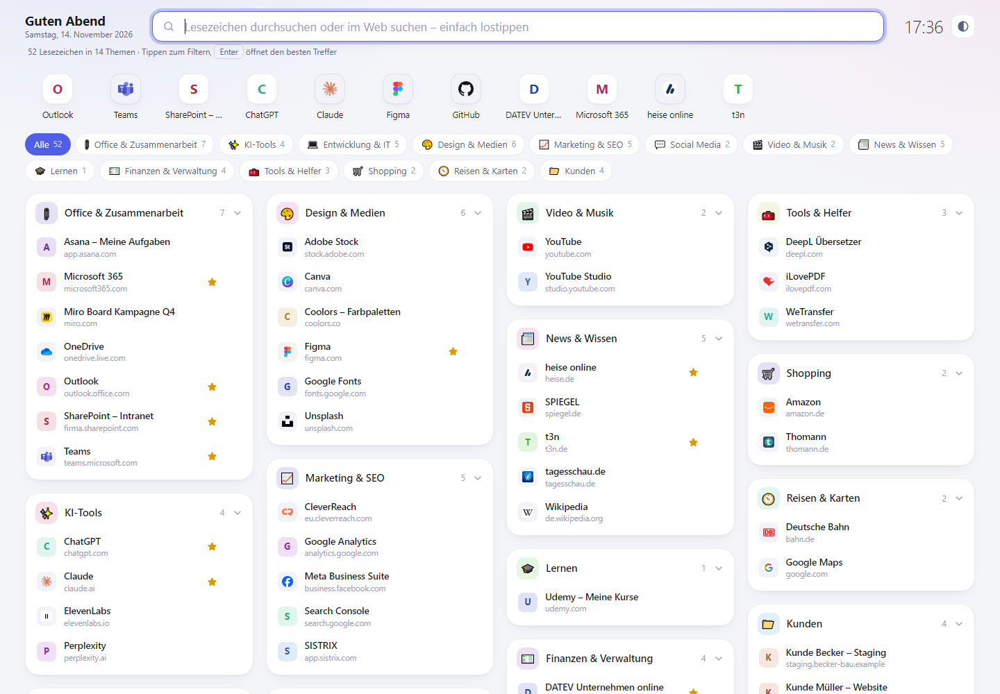

# startpage-from-bookmarks

[English](README.md) · **Deutsch**

Macht aus den Lesezeichen **aller Browser** eine schnelle, lokale Startseite – zusammengeführt, ohne Dubletten und nach Themen gegliedert.
Windows & macOS, ohne Server, ohne Installation, ohne Cloud.

## Funktionen

- **Alle Browser auf einmal** – Chrome, Edge, Brave, Vivaldi, Chromium, Opera, Opera GX (alle Profile), Firefox (alle Profile) und Safari (macOS).
- **Dubletten automatisch zusammengeführt** – gleiche Adresse = ein Eintrag, unabhängig von `http`/`https`, `www.`, `/` am Ende, `index.html` oder Tracking-Parametern (`utm_*`, `fbclid`, `gclid` …). Der Tooltip zeigt, aus welchen Browsern ein Link stammt.
- **Nach Themen gegliedert** – rund 300 bekannte Dienste werden erkannt (Office, KI-Tools, Design, Marketing, Finanzen …), dazu Stichworte und die eigenen Lesezeichen-Ordner. Vollständig anpassbar in `kategorien.json`.
- **Schnellzugriff** – Links aus der Lesezeichenleiste erscheinen als Kacheln; ☆ legt jeden Link dort ab, × nimmt ihn wieder heraus.
- **Ausblenden** – × oder <kbd>Entf</kbd> blendet einen Link aus (mit *Rückgängig* und einer Liste zum Wiedereinblenden).
- **Sofortsuche** – einfach lostippen; <kbd>Enter</kbd> öffnet den besten Treffer, <kbd>Strg</kbd>+<kbd>Enter</kbd> sucht im Web.
- **Themen-Filter** – die Themen-Buttons sind Schalter und lassen sich kombinieren.
- **Hell / Dunkel / Automatisch**, responsiv, jeder Link öffnet in einem neuen Tab.
- **Deutsch & Englisch (US)** – richtet sich nach der Browsersprache; das Einrichtungsfenster nach der Systemsprache.
- **Merkt sich alles** (Favoriten, Ausgeblendetes, Filter, eingeklappte Themen, Darstellung) pro Browser – bleibt beim automatischen Neuaufbau erhalten.
- **Privat** – alles bleibt auf dem Rechner. Nach außen gehen nur die Favicon-Abrufe, und die lassen sich abschalten.

## Installation

### Windows

1. Repository herunterladen (**Code → Download ZIP**) und entpacken.
2. **`Installieren.cmd`** doppelklicken → das Fenster **„Startseite einrichten“** öffnet sich.
3. Optionen anhaken und **Einrichten** klicken.

| Option | Wirkung |
|---|---|
| Bei jeder Anmeldung automatisch aktualisieren | Autostart-Eintrag, baut die Seite bei jeder Windows-Anmeldung neu |
| Verknüpfung „Startseite“ auf dem Desktop | `Startseite.url` auf dem Desktop |
| Firefox: als Startseite eintragen | wird automatisch gesetzt (über `user.js`), gilt nach Firefox-Neustart |
| Chrome / Edge / Brave: Einstellungen öffnen | Diese Browser lassen sich die Startseite nicht von Programmen setzen. Die Adresse wird in die Zwischenablage kopiert und die Einstellungsseite „Beim Start“ geöffnet – dort *Neue Seite hinzufügen → Strg+V*. |
| Fest als Richtlinie eintragen (Administrator) | setzt die Startseite für Chrome/Edge/Brave per Richtlinie; fragt nach Adminrechten und greift nur auf domänen- bzw. Intune-verwalteten Geräten |

Erneut ausführen ändert die Auswahl, abgewählte Optionen werden zurückgenommen. Entfernen über **Entfernen** im Fenster oder **`Deinstallieren.cmd`**.
Vorschau mit Beispieldaten: **`Demo-ansehen.cmd`**.

Benötigt nur Windows PowerShell 5.1 (in Windows 10/11 enthalten).

### macOS

1. **`Startseite-Mac.zip`** aus dem [neuesten Release](https://github.com/madmus2025/startpage-from-bookmarks/releases/latest) herunterladen und entpacken (die Starter darin sind bereits ausführbar).
2. **`Installieren-Mac.command`** doppelklicken → Optionen wählen (**⌘-Klick** zum An-/Abwählen) → **Einrichten**.
3. Blockiert macOS den Start (*„nicht verifizierter Entwickler“*): **Systemeinstellungen → Datenschutz & Sicherheit → „Dennoch öffnen“** (ältere macOS: Rechtsklick → Öffnen). Kopiert die IT den Ordner per Netzlaufwerk/MDM, tritt das meist nicht auf.

| Option | Wirkung |
|---|---|
| Bei Anmeldung und alle 2 Stunden aktualisieren | LaunchAgent `~/Library/LaunchAgents/local.startseite.aktualisieren.plist` – Macs werden selten neu angemeldet, daher zusätzlich alle 2 Std. |
| Verknüpfung auf dem Schreibtisch | `Startseite.webloc` |
| Firefox: als Startseite eintragen | automatisch über `user.js` |
| Safari / Chrome / Edge / Brave: Einstellungen öffnen | Adresse in die Zwischenablage, Browser öffnet sich – dort einfügen (Safari: *Einstellungen → Allgemein → Homepage*) |

Ablage: `~/Library/Application Support/Startseite/index.html`. Entfernen: **`Deinstallieren-Mac.command`**.

**Safari-Lesezeichen** liegen in einem geschützten Ordner. Damit sie gelesen werden können, unter *Systemeinstellungen → Datenschutz & Sicherheit → Festplattenvollzugriff* **Terminal** erlauben – und für die automatische Aktualisierung zusätzlich **`/usr/bin/osascript`** (mit ⌘⇧G den Pfad eingeben). Ohne diese Freigabe funktioniert alles andere.

Ohne Doppelklick (Terminal): `osascript -l JavaScript ~/Downloads/Startseite/Startseite-mac.js --einrichten`

Benötigt nur macOS (JavaScript for Automation ist eingebaut).

## Verteilung im Unternehmen

- **Ohne Fenster (Anmeldeskript / GPO / Intune):**
  `powershell.exe -NoProfile -ExecutionPolicy Bypass -File "\\server\freigabe\Startseite\Startseite.ps1" -Installieren`
  richtet Seite, Autostart und Firefox ein. Mit **`-Richtlinie`** (als Administrator) zusätzlich die Richtlinie für Chrome/Edge/Brave.
- **Warum nicht einfach für alle per Richtlinie?** Windows erlaubt Schreiben unter `HKCU\Software\Policies` nur Administratoren, und Chrome/Edge beachten `HomepageLocation` nur auf **domänen- oder Intune-verwalteten** Rechnern. Auf verwalteten Geräten kann die IT die Richtlinie zentral setzen – mit dem Pfad pro Benutzer `file:///C:/Users/<Name>/AppData/Local/Startseite/index.html` (GPO löst `%LOCALAPPDATA%` hier nicht auf).

## Anpassen

Alles Firmenspezifische steht in **`kategorien.json`**:

- `kategorien` – Themen mit `name`, `name_en` (englischer Anzeigename), `icon` (Emoji), `domains` (z. B. `"sharepoint.com"`, auch mit Pfad wie `"linkedin.com/learning"`) und `stichworte`. Reihenfolge = Reihenfolge auf der Seite. Tipp: interne Domains (z. B. `"intranet.example.com"`) bei *Intranet & Firma* eintragen.
- `suche` – Suchmaschine für die Websuche (z. B. `https://duckduckgo.com/?q=`)
- `favicons` – `"direkt"` (von der jeweiligen Website), `"duckduckgo"`, `"google"` oder `"aus"` (nur Buchstaben-Icons, keine externen Anfragen)
- `ignorieren` – Domains, die nie angezeigt werden
- `eintraegeProKarte`, `schnellzugriffMax`, `mindestOrdnerGroesse`, `titel` / `titel_en`

Aussehen: `startseite.vorlage.html` (reines HTML/CSS/JS – Platzhalter `/*__DATEN__*/null` nicht entfernen).
Sprache zum Testen erzwingen: `index.html?lang=en` bzw. `?lang=de`.

## So werden Themen zugeordnet

1. Domain-Regeln – die genaueste (längste) passende Regel gewinnt
2. Stichworte im Ordnernamen des Nutzers
3. Eigener oberster Lesezeichen-Ordner (ab 3 Einträgen)
4. Stichworte in Titel / Domain
5. sonst *Sonstiges*

## Was sich die Startseite merkt

Pro Rechner und Browser (lokal im Browser gespeichert, übersteht den Neuaufbau): Themen-Filter · eingeklappte Themen · „+ N weitere“ aufgeklappt · Hell/Dunkel · Favoriten · ausgeblendete Links.
Werden die Browserdaten inkl. Website-Daten gelöscht, ist alles wieder auf Standard.

## Bekannte Grenzen

- **Neuer Tab:** Chrome/Edge erlauben für die „Neuer Tab“-Seite keine lokale Datei. Die Startseite erscheint beim Browserstart und über den Home-Button (Alt+Pos1).
- **Firefox** wird aus der automatischen Lesezeichen-Sicherung gelesen, die Firefox etwa einmal täglich schreibt – ganz neue Firefox-Lesezeichen erscheinen ggf. erst am nächsten Tag.
- **Lesezeichen werden nie verändert.** Ausblenden und Favoriten wirken nur auf der Startseite; eine statische Seite kann Browser-Lesezeichen nicht ändern.
- Arc und Browser im Microsoft-Store-Sandboxing werden nicht unterstützt; Safari nur auf dem Mac (mit Festplattenvollzugriff).
- Die Mac-Fassung ist noch nicht auf vielen macOS-Versionen erprobt – Rückmeldungen willkommen.

## Aufbau

| Datei | Zweck |
|---|---|
| `Startseite.ps1` | Generator & Einrichtung für Windows (PowerShell 5.1) |
| `Startseite-mac.js` | Generator & Einrichtung für macOS (JavaScript for Automation) – gleiche Logik wie `Startseite.ps1`, bitte beide synchron halten |
| `kategorien.json` | Themen-Regeln und Einstellungen |
| `startseite.vorlage.html` | Vorlage der Seite (Design, Suche, Sprachen) |
| `Installieren.cmd`, `Deinstallieren.cmd`, `Demo-ansehen.cmd` | Starter für Windows |
| `Installieren-Mac.command`, `Deinstallieren-Mac.command` | Starter für macOS |
| `tools/mac-zip-bauen.py` | baut `Startseite-Mac.zip` mit ausführbaren Startern (nur für Maintainer) |

## Lizenz

[MIT](LICENSE) © 2026 madmus2025
