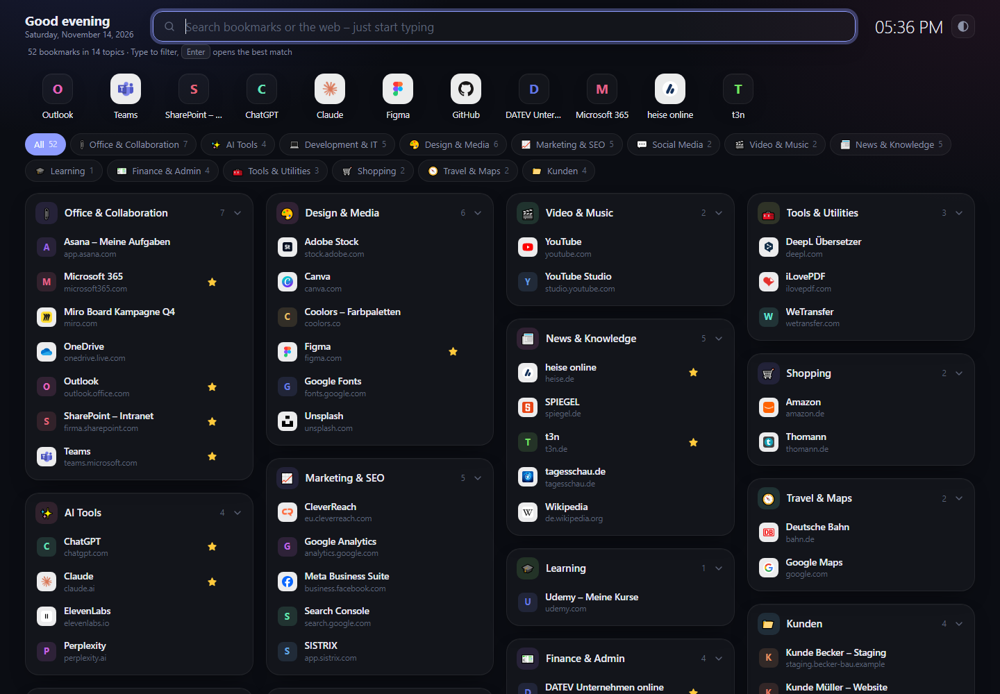

# startpage-from-bookmarks

**English** · [Deutsch](README.de.md)

Turns the bookmarks of **all your browsers** into one fast, local start page – merged, de-duplicated and grouped by topic.
Windows & macOS, no server, no install, no cloud.



## Features

- **All browsers at once** – Chrome, Edge, Brave, Vivaldi, Chromium, Opera, Opera GX (all profiles), Firefox (all profiles) and Safari (macOS).
- **Duplicates merged automatically** – same address = one entry, regardless of `http`/`https`, `www.`, trailing `/`, `index.html` or tracking parameters (`utm_*`, `fbclid`, `gclid` …). The tooltip shows which browsers a link came from.
- **Grouped by topic** – ~300 well-known services are recognised (Office, AI tools, design, marketing, finance …), plus keywords and the user's own bookmark folders. Fully configurable in `kategorien.json`.
- **Quick access** – links from the bookmarks bar appear as tiles; ☆ pins any link there, × removes it. <kbd>Alt</kbd>+<kbd>1</kbd>…<kbd>9</kbd> (Mac: <kbd>⌥</kbd>) opens the first nine tiles – hold <kbd>Alt</kbd> to see their numbers.
- **Company links for everyone** – IT adds links (intranet, helpdesk, time tracking …) once in `kategorien.json`; they appear on every employee's page, even without a bookmark.
- **Learns what you use** – clicks are counted locally; links you use often move to the top of their topic and win in search. Old clicks fade out after a few weeks.
- **Hide links** – × or <kbd>Del</kbd> hides a link from the page (with *Undo* and a list to restore them).
- **Instant search** – just start typing; <kbd>Enter</kbd> opens the best match, <kbd>Ctrl</kbd>+<kbd>Enter</kbd> searches the web.
- **Topic filter** – topic buttons act as toggles and can be combined.
- **Your own topics** – ⇄ on any link (or just drag it onto a card or topic button) assigns it to another topic or to a new one of your own. Tick *All links from …* to move a whole domain, including bookmarks added later. Rename, reorder and give icons to topics under ⚙ *Settings → Topics*.
- **Appearance** – accent colour, density (compact / normal / airy) and card width under ⚙ *Settings → Appearance*.
- **Take your settings along** – ⚙ *Settings → Transfer* exports pins, hidden links, topics and appearance as a file and imports them in another browser or on another computer.
- **Light / dark / automatic**, responsive, every link opens in a new tab.
- **German & English (US)** – follows the browser language; the setup dialog follows the system language.
- **Remembers your choices** (pins, hidden links, topic assignments, own topics, appearance, filter, collapsed topics, usage) per browser – they survive the automatic rebuild.
- **Private** – everything stays on the computer. The only outbound requests are favicons, which can be switched off.

## Installation

### Windows

1. Download the repository (**Code → Download ZIP**) and unzip it.
2. Double-click **`Installieren.cmd`** → the *Set up start page* dialog opens.
3. Choose the options and click **Set up**.

| Option | What it does |
|---|---|
| Update automatically (whenever bookmarks change) | Autostart entry that starts a small invisible watcher at sign-in. It rebuilds the page within seconds whenever a browser saves its bookmarks (Chrome, Edge, Brave, Vivaldi, Opera, Firefox backups), plus every 2 hours. |
| Desktop shortcut | `Startseite.url` on the desktop |
| Firefox: set as home page | set automatically via `user.js`, takes effect after restarting Firefox |
| Chrome / Edge / Brave: open settings | These browsers don't let programs change the home page. The address is copied to the clipboard and the *On startup* settings page opens – just *Add a new page → Ctrl+V*. |
| Enforce as policy (administrator) | sets the home page for Chrome/Edge/Brave via policy; asks for admin rights and only works on domain- or Intune-managed devices |

Running it again changes the selection; deselected options are reverted. Remove everything via **Remove** in the dialog or **`Deinstallieren.cmd`**.
Preview with sample data: **`Demo-ansehen.cmd`**.

Requires only Windows PowerShell 5.1 (built into Windows 10/11).

### macOS

1. Download **`Startseite-Mac.zip`** from the [latest release](https://github.com/madmus2025/startpage-from-bookmarks/releases/latest) and unzip it (the launchers inside are already executable).
2. Double-click **`Installieren-Mac.command`** → choose options (**⌘-click** to toggle) → **Set up**.
3. If macOS blocks it (*"unidentified developer"*): **System Settings → Privacy & Security → Open Anyway** (older macOS: right-click → Open).

| Option | What it does |
|---|---|
| Update automatically | LaunchAgent `~/Library/LaunchAgents/local.startseite.aktualisieren.plist` – rebuilds the page within seconds whenever a bookmark file changes (Chrome/Edge/Brave/…, Safari, Firefox backups), plus at login and every 2 hours |
| Desktop shortcut | `Startseite.html` (a link to the page; macOS no longer opens `.webloc` files that point to a local file) |
| Firefox: set as home page | automatic via `user.js` |
| Safari / Chrome / Edge / Brave: open settings | address copied to the clipboard, browser opens – paste it there (Safari: *Settings → General → Homepage*) |

The page is stored at `~/Library/Application Support/Startseite/index.html`. Remove with **`Deinstallieren-Mac.command`**.

**Safari bookmarks** live in a protected folder. To include them, allow **Terminal** under *System Settings → Privacy & Security → Full Disk Access* – and **`/usr/bin/osascript`** for automatic updates (press ⌘⇧G to enter the path), then run `Installieren-Mac.command` again. Everything else works without it. The setup dialog lists every browser it found with its bookmark count and offers a button that opens the Full Disk Access settings.

Without double-click: `osascript -l JavaScript ~/Downloads/Startseite/Startseite-mac.js --einrichten`

Requires nothing but macOS (JavaScript for Automation is built in).

## Rolling out in a company

- **Silent install (logon script / GPO / Intune):**
  `powershell.exe -NoProfile -ExecutionPolicy Bypass -File "\\server\share\Startseite\Startseite.ps1" -Installieren`
  sets up the page, autostart and Firefox. Add **`-Richtlinie`** (as administrator) to also set the Chrome/Edge/Brave policy.
- **Why not a policy for everyone?** Windows only lets administrators write to `HKCU\Software\Policies`, and Chrome/Edge only honour `HomepageLocation` on **domain- or Intune-managed** machines. On managed devices IT can set the policy centrally with the per-user path `file:///C:/Users/<name>/AppData/Local/Startseite/index.html` (GPO does not expand `%LOCALAPPDATA%` here).

## Customising

Everything company-specific lives in **`kategorien.json`**:

- `kategorien` – topics with `name`, `name_en` (English display name), `icon` (emoji), `domains` (e.g. `"sharepoint.com"`, also with a path like `"linkedin.com/learning"`) and `stichworte` (keywords). Order = order on the page. Tip: add internal domains (e.g. `"intranet.example.com"`) to *Intranet & Company*.
- `firmenlinks` – links shown to everyone, see below
- `suche` – web search engine (e.g. `https://duckduckgo.com/?q=`)
- `favicons` – `"direkt"` (loaded from each site), `"duckduckgo"`, `"google"` or `"aus"` (letter icons only, no outbound requests)
- `ignorieren` – domains that are never shown
- `eintraegeProKarte`, `schnellzugriffMax`, `mindestOrdnerGroesse`, `titel` / `titel_en`

### Company links

```json
"firmenlinks": [
  { "titel": "Intranet",  "url": "https://intranet.example.com", "thema": "Intranet & Firma", "schnellzugriff": true },
  { "titel": "IT helpdesk", "url": "https://helpdesk.example.com", "thema": "Intranet & Firma", "schnellzugriff": true },
  { "titel": "Time tracking", "url": "https://time.example.com" }
]
```

- `titel`, `url` – required
- `thema` – topic name (German `name` or `name_en`); an unknown name creates its own topic; without it the normal rules apply
- `schnellzugriff` – `true` puts the link in quick access, ahead of the user's own tiles (in this order, so `Alt+1` is always the first company link)

If an employee has the same link as a bookmark, both are merged; the company title wins. Employees can still unpin or hide company links on their own page.

Look & feel: `startseite.vorlage.html` (plain HTML/CSS/JS – keep the placeholder `/*__DATEN__*/null`).
Force a language for testing: `index.html?lang=en` or `?lang=de`.

## How topics are assigned

1. Domain rules – the most specific (longest) match wins
2. Keywords in the user's folder name
3. The user's own top-level bookmark folder (if it has at least 3 entries)
4. Keywords in title / domain
5. otherwise *Other*

Your own assignments on the page come first: a single link moved via ⇄ beats a domain rule you set there, which beats the rules above.

## Known limitations

- **New tab page:** Chrome/Edge don't allow a local file as the new tab page. The start page appears at browser start and via the Home button (Alt+Home).
- **Firefox** is read from its automatic bookmark backup, which Firefox writes about once a day – brand-new Firefox bookmarks may appear a day later. Chromium browsers and Safari update within seconds. New browsers or profiles are picked up at the next sign-in (Windows) or after running the installer again (macOS). An already open start page shows changes after reloading.
- **Bookmarks are never changed.** Hiding or pinning only affects the start page; a static page cannot modify browser bookmarks.
- Arc and sandboxed Microsoft Store browsers are not supported; Safari only on macOS (with Full Disk Access).
- The macOS version has not yet been tested on a wide range of macOS versions – feedback welcome.

## Project structure

| File | Purpose |
|---|---|
| `Startseite.ps1` | Generator & setup for Windows (PowerShell 5.1) |
| `Startseite-mac.js` | Generator & setup for macOS (JavaScript for Automation) – same logic as `Startseite.ps1`, please keep both in sync |
| `kategorien.json` | Topic rules and settings |
| `startseite.vorlage.html` | Page template (design, search, i18n) |
| `Installieren.cmd`, `Deinstallieren.cmd`, `Demo-ansehen.cmd` | Windows launchers |
| `Installieren-Mac.command`, `Deinstallieren-Mac.command` | macOS launchers |
| `tools/mac-zip-bauen.py` | Builds `Startseite-Mac.zip` with executable launchers (maintainers only) |

File and setting names are German because the project started as an internal tool for a German team.

## License

[MIT](LICENSE) © 2026 madmus2025
